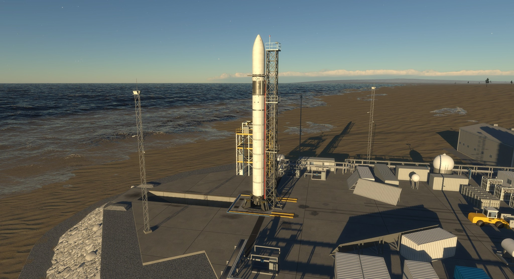
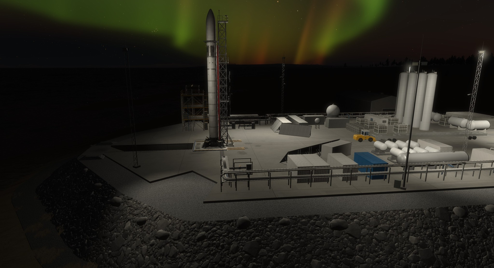

# Andoya Spaceport  

A launch site for [Kitten Space Agency](https://ahwoo.com/app/100000/kitten-space-agency) at Andoya, an island in northern Norway at 69 degrees north. It adds "Andoya Spaceport" to the launch site list of the vehicle editor. No stock launch site is changed.

Validated against KSA build version 2026.11.10.5801.

*The launch video, made in the game with these mods.*

## What is in it

- One launch pad on a quay, with a flame trench to the sea, rock armour and a road.
- Access tower, light masts, pipe racks, valve skids, tank farm, containers, a hall, a trailer and a wheel loader.
- Lamps that light the pad at night and fade in when the sun sinks below 8 degrees.
- Sun shadows of the whole site when the vessel shadows are on in the graphics settings. The game draws no shadows for launch sites, so the mod adds them.
- A kitten can walk the tower stairs and the open flame trench.

## Launching

Keep legs, fins and boosters within about 15 m of the vehicle axis; a base wider than about 28 m does not fit the pad. At 69 degrees north the sun does not rise for some weeks around the winter solstice, so a new game can start in the dark.

The layout of the pad and the tank farm follows public aerial pictures; the other sizes are estimates. The site stands about 1 km west-north-west of the real pad, because the game terrain there is a hillside.

## Install

Requires [StarMap](https://github.com/StarMapLoader/StarMap) for the lamps and the shadows. Without it the site exists, but stays dark and has no shadows.

- Borea: install Andoya Spaceport from the content list.
- By hand: copy `AndoyaSpaceport` from the release zip into `Documents/My Games/Kitten Space Agency/mods/` and enable it.

To remove the mod, delete its folder.

Works well with [Prisma by Purrline Rocketworks](https://github.com/Maximilian-Nesslauer/KSA-PurrlinePrisma), a small launcher that fits the pad.

## Build the code

The release zip has the built `AndoyaSpaceport.dll`; git has only the source in `src/`. Build with `dotnet build -c Release` in `src/` and `-p:KsaDir=<KSA install folder>` `-p:StarMapDir=<folder with 0Harmony.dll>` (or the environment variables `KSA_DIR` and `STARMAP_DIR`), then copy the DLL into the mod folder.

## Licence

Code and game data: MIT ([LICENSE](LICENSE)). Meshes, textures and pictures: CC BY 4.0 ([LICENSE-ART](LICENSE-ART)). Credits: [NOTICE.md](NOTICE.md).

## Links

[Forum thread](https://forums.ahwoo.com/threads/andoya-spaceport.ID/) | [Issues](https://github.com/Maximilian-Nesslauer/KSA-AndoyaSpaceport/issues)
